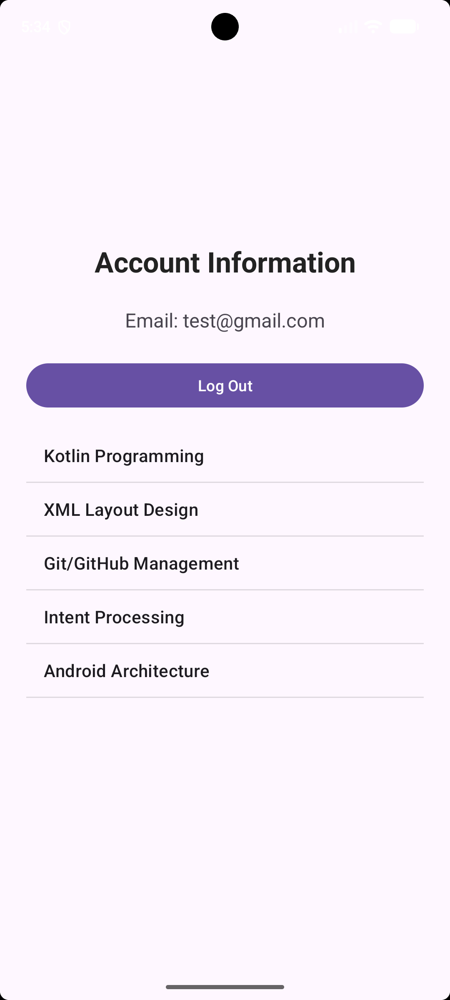
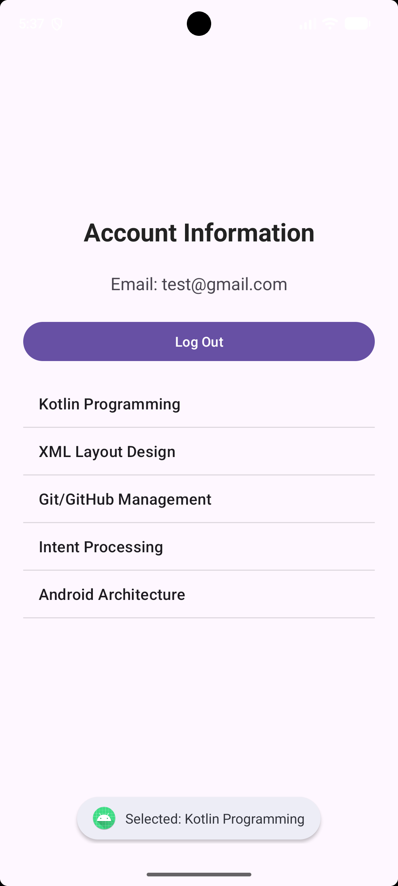

# KIỂM TRA LẬP TRÌNH ỨNG DỤNG DI ĐỘNG

- Họ tên: Phạm Thị Khánh 
- MSSV: 2474802016786
- Ngôn ngữ: Kotlin
- IDE: Android Studio

## Câu 1: Login và Input Validation

Ứng dụng xây dựng giao diện đăng nhập sử dụng
ConstraintLayout và findViewById.

### Chức năng
- Kiểm tra Email không được để trống.
- Kiểm tra Password không được để trống.
- Kiểm tra định dạng Email bằng Patterns.EMAIL_ADDRESS.
- Kiểm tra Password có ít nhất 6 ký tự.
- Hiển thị thông báo khi dữ liệu hợp lệ.

### Minh chứng kiểm tra dữ liệu sai

### Minh chứng kiểm tra dữ liệu hợp lệ

## Câu 2: Explicit Intent và Bundle Extra

- Tạo màn hình ProfileActivity.
- Chuyển màn hình bằng Explicit Intent.
- Truyền Email bằng putExtra().
- Nhận Email bằng getStringExtra().
- Nhấn Log Out để trở về LoginActivity.

### Minh chứng Câu 2

## Câu 3: ListView và ArrayAdapter

- Hiển thị 5 môn học bằng ListView.
- Sử dụng findViewById.
- Sử dụng ArrayAdapter với simple_list_item_1.
- Hiển thị Toast khi nhấn vào môn học.

### Minh chứng danh sách

### Minh chứng Toast

