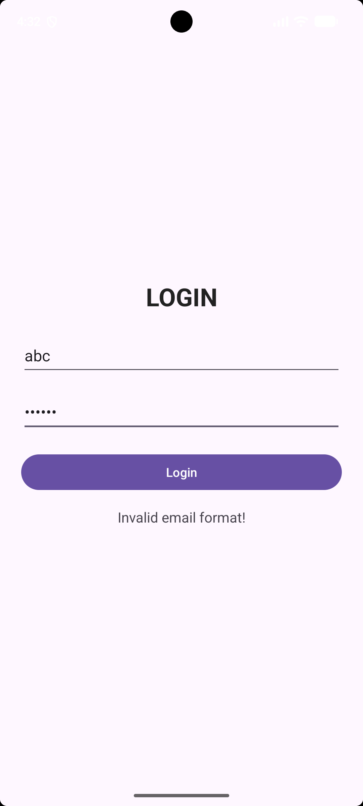
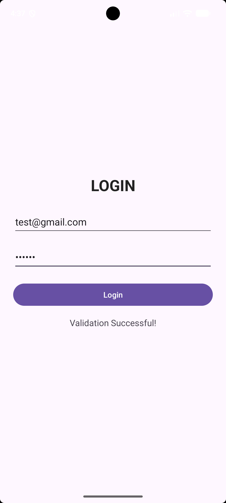

# KIỂM TRA LẬP TRÌNH ỨNG DỤNG DI ĐỘNG

- Họ tên: Phạm Thị Khánh 
- MSSV: 2474802016786
- Ngôn ngữ: Kotlin
- IDE: Android Studio

## Câu 1: Login và Input Validation

Ứng dụng xây dựng giao diện đăng nhập sử dụng
ConstraintLayout và findViewById.

### Chức năng
- Kiểm tra Email không được để trống.
- Kiểm tra Password không được để trống.
- Kiểm tra định dạng Email bằng Patterns.EMAIL_ADDRESS.
- Kiểm tra Password có ít nhất 6 ký tự.
- Hiển thị thông báo khi dữ liệu hợp lệ.

### Minh chứng kiểm tra dữ liệu sai

### Minh chứng kiểm tra dữ liệu hợp lệ

